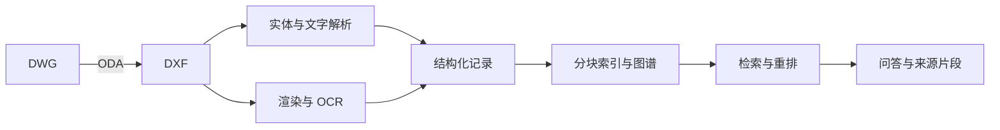

# CAD 图纸检索问答

将 CAD 图纸解析为结构化知识库，通过中文问题查询图号、图层、尺寸和构件信息。回答附带来源片段，并支持连续围绕同一张图纸提问。

后端使用 Python 和 FastAPI，图纸解析使用 ezdxf。示例采用 BM25 检索和本地抽取式回答，可选向量检索、混合检索、重排、知识图谱扩展及模型生成。

## 功能与流程

- 提取 DXF 中的文字、图层、实体、块和尺寸；DWG 通过 ODA File Converter 转换。
- 渲染图纸，关联 OCR 结果与矢量文字，生成结构化记录。
- 对图纸内容分块检索，返回回答依据和图纸预览。
- 通过网页上传图纸、查看入库进度并进行多轮问答。
- 使用 SQLite 保存会话和入库任务。



## 快速开始

建议使用 Python 3.13 和虚拟环境。在项目根目录运行：

```bash
python -m pip install -r requirements-demo.txt
python scripts/prepare_public_demo.py
python scripts/check_public_demo.py
python -m uvicorn app.main:app --host 127.0.0.1 --port 8000
```

打开 <http://127.0.0.1:8000/ui>，选择本地回答模式。API 文档位于 <http://127.0.0.1:8000/docs>。

准备脚本会生成一张工程示意图并建立索引。此示例使用 DXF 原生文字、启发式摘要和 BM25，不运行 OCR，也不需要模型密钥。脚本要求 `datasets/` 为空，避免覆盖或混入已有数据。

示例问题：

- 工程示意平面图的图号是什么？
- 它有哪些图层？
- 工程示意平面图梁长尺寸是多少？

## 图纸入库

完整依赖见 `requirements.txt`，包含 OCR 和向量检索所需的包。当前 OCR 管线使用 Python 3.13；处理 DWG 需安装 ODA File Converter。向量模式首次使用时需要下载模型。

配置完成后，可在网页上传 DWG/DXF，等待入库结束后提问。批处理脚本按以下顺序执行：

```text
convert_dwg.py → parse_dxf.py → render_dxf.py → ocr_images.py
→ merge_ocr.py → vlm_understand.py → build_final.py
→ build_standards.py → build_index.py → build_graph.py
→ build_embeddings.py（向量检索时）
```

## 配置

将 `.env.example` 复制为 `.env`，按需填写以下配置。`.env` 不纳入版本管理。

| 变量 | 用途 |
| --- | --- |
| `CAD_GENERATE` | `extractive` 本地回答；`auto`、`qwen`、`deepseek` 模型生成 |
| `CAD_RAG_BACKEND` | `bm25`、`dense`、`hybrid` |
| `DASHSCOPE_API_KEY` | Qwen 文本及视觉接口密钥 |
| `DEEPSEEK_API_KEY` | DeepSeek 接口密钥 |
| `CAD_OCR_PYTHON` | OCR 使用的 Python 3.13 可执行文件 |
| `ODA_FILE_CONVERTER` | ODA 转换器路径 |

启用云端模型后，问题、检索片段或图像会发送至对应服务。模型名称需与服务账户支持的型号一致。

## 测试

```bash
python scripts/validate_json.py
python scripts/check_public_demo.py
```

CI 会从合成图纸开始构建索引，检查各阶段 JSON 结构、问答依据和多轮图纸关联。

`smoke_test.py`、`eval_qa.py`、`eval_embeddings.py` 和 `demo_defense.py` 依赖额外样例集，运行前需自行准备对应数据。仓库不包含该样例集。

## 目录

| 目录 | 内容 |
| --- | --- |
| `app/` | API、网页界面、检索、生成、图谱与会话管理 |
| `scripts/` | 图纸处理、索引构建、示例生成与评测 |
| `schemas/` | 各处理阶段的 JSON Schema |
| `datasets/` | 本地生成的图纸、索引和会话数据，不纳入版本管理 |

## 限制

当前仅支持图纸读取、检索和问答，不提供 AutoCAD 编辑或写回。识别效果受图纸标注和解析质量影响；标准知识库中的教学摘要不能替代正式工程标准。

服务默认用于本地运行，尚未实现完整的用户认证与权限隔离。自动测试覆盖本地示例流程，云端模型、OCR、DWG 转换和向量后端需要分别验证。
