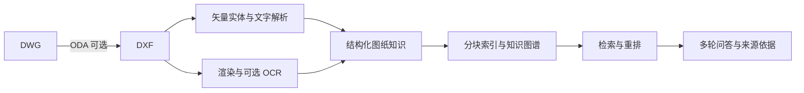

# CAD 图纸知识库 RAG 检索问答智能体

面向 CAD 工程图纸的知识检索与问答原型：将图纸解析为结构化内容，通过中文问题查找图号、图层、尺寸和构件信息，并返回检索依据。

本仓库公开应用源码、处理脚本和可复现的合成演示。**不包含原项目图纸、业务数据、历史对话、索引或 API 密钥。**

## 项目能力

- **图纸解析**：通过 ezdxf 提取 DXF 实体、文字、图层、块、尺寸等；DWG 转换需要另外安装 ODA File Converter。
- **多源处理**：图纸渲染、OCR 与矢量文字关联；支持启发式视觉摘要或可选的视觉模型接口。
- **知识检索**：BM25 检索，可选向量检索、混合检索、重排及轻量知识图谱扩展。
- **多轮问答**：保留当前图纸上下文，返回回答、来源片段及可用的图纸预览。
- **交互界面**：FastAPI 服务、网页聊天、DWG/DXF 上传入库、任务状态与 SQLite 会话存储。
- **生成方式**：支持本地抽取式回答，以及可选的 Qwen / DeepSeek 接口。

这是图纸知识检索与问答项目，当前工具用于只读查询，不提供 AutoCAD 改图写回功能。

## 处理流程



## 本地快速演示

建议使用 Python 3.13 和虚拟环境。在项目根目录运行（Windows 可将 `python` 换成 `py -3.13`）：

```bash
python -m pip install -r requirements-demo.txt
python scripts/prepare_public_demo.py
python scripts/check_public_demo.py
python -m uvicorn app.main:app --host 127.0.0.1 --port 8000
```

打开 <http://127.0.0.1:8000/ui>，选择本地回答模式。接口文档：<http://127.0.0.1:8000/docs>。

准备脚本会在本地生成一张教学用工程示意图，并建立索引。**这个轻量演示只使用原生 DXF 文字，跳过 OCR，使用启发式摘要与 BM25，不调用付费 API，也不下载大模型。** 为避免混合已有数据，脚本要求 `datasets/` 为空；请在新克隆目录运行。

可以提问：

- 工程示意平面图的图号是什么？
- 它有哪些图层？
- 工程示意平面图梁长尺寸是多少？

## 完整管线与可选配置

完整依赖见 `requirements.txt`，包括 OCR 和向量模型相关包。OCR 管线按现有实现使用 Python 3.13；DWG 转换依赖外部 ODA 软件。向量模式首次运行可能下载模型。

将 `.env.example` 复制为 `.env` 后按需配置；密钥只保存在本地。常用配置：

| 变量 | 用途 |
| --- | --- |
| `CAD_GENERATE` | `extractive` 本地回答；`auto`、`qwen`、`deepseek` 可选模型生成 |
| `CAD_RAG_BACKEND` | `bm25`、`dense`、`hybrid` |
| `DASHSCOPE_API_KEY` | Qwen 文本及视觉接口密钥 |
| `DEEPSEEK_API_KEY` | DeepSeek 接口密钥 |
| `CAD_OCR_PYTHON` | OCR 使用的 Python 3.13 可执行文件路径 |
| `ODA_FILE_CONVERTER` | ODA 转换器路径 |

启用云端生成或视觉模式时，相关问题、检索内容或图像会发送给所配置的模型服务。仅处理你有权使用的数据。模型名称与可用性请按自己的服务账户配置。

完整离线管线顺序：

```text
convert_dwg.py → parse_dxf.py → render_dxf.py → ocr_images.py
→ merge_ocr.py → vlm_understand.py → build_final.py
→ build_standards.py → build_index.py → build_graph.py
→ build_embeddings.py（向量检索时）
```

安装完整依赖及外部工具后，也可在网页上传自己的 DWG/DXF，等待入库任务完成后提问。

## 目录与验证

| 目录 | 内容 |
| --- | --- |
| `app/` | API、聊天界面、检索、生成、图谱、会话及入库 |
| `scripts/` | 解析、渲染、OCR、索引、演示生成与评测 |
| `schemas/` | 各处理阶段 JSON Schema |
| `datasets/` | 本地生成的数据，整体排除在 Git 之外 |

公开仓库 CI 从源码生成合成图纸，验证 JSON Schema，并检查 API 回答、来源证据和多轮图纸关联。

原有 `smoke_test.py`、`eval_qa.py`、`eval_embeddings.py` 与 `demo_defense.py` 涉及原样例集；该数据集未随公开版分发，不能直接视为公开版测试。公开版请使用 `prepare_public_demo.py` 和 `check_public_demo.py`。

## 当前边界

- 项目为原型；检索和回答效果依赖图纸质量、标注和数据处理结果。
- 标准知识脚本中的内容为教学摘要，不替代正式工程标准或专业审核。
- 本地服务未提供完整的生产级用户认证与权限隔离，演示默认绑定本机地址。
- 公开演示验证本地矢量检索与问答流程，不代表云端模型、OCR、DWG 转换或所有向量后端均已验证。
